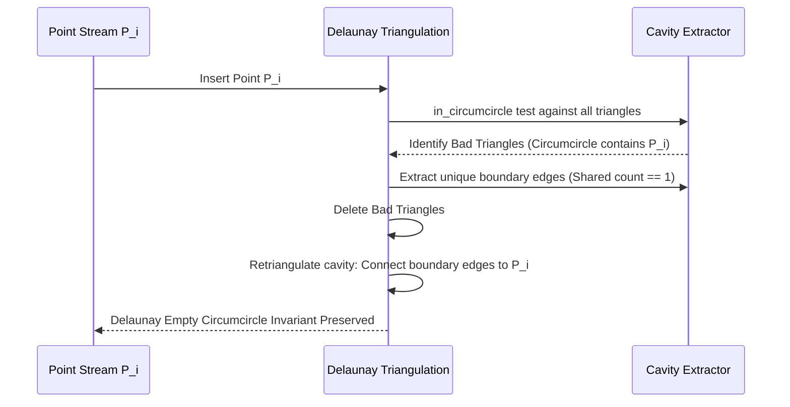

# Geometric Mesh Generation in Practice: Delaunay Triangulation, Bowyer-Watson Cavity Invariants, and 3D TIN Surfaces in Lateralus

In computational geometry, computer graphics (surface reconstruction, physics simulation), and civil engineering (Geographic Information Systems, Finite Element Analysis), turning an unstructured cloud of planar measurement points into a contiguous, non-overlapping polygonal mesh is a foundational challenge.

A naive triangulation often produces pathological "silver slivers"—extremely elongated, needle-like triangles with angles approaching zero. In Finite Element Analysis (FEA), sliver triangles degrade the condition number of stiffness matrices, causing numerical divergence.

In 1934, Soviet mathematician Boris Delaunay introduced the **Delaunay Triangulation** (*"Sur la sphère vide"*, Bulletin of the Academy of Sciences of the USSR). By enforcing the **Empty Circumcircle Criterion**, Delaunay triangulations maximize the minimum angle across all triangles, completely eliminating degeneracies. In 1981, Adrian Bowyer and David Watson independently formulated the **Bowyer-Watson Algorithm**, an elegant incremental cavity-retriangulation technique operating in sub-quadratic time.

In this standard library tutorial, we present the mathematical foundation, exact algebraic determinant tests, and an idiomatic vector implementation of **Delaunay Triangulation** in **Lateralus** (`stdlib/delaunay_triangulation.ltl`).

---

## 1. Geometric Foundations & Invariants

### 1.1 The Empty Circumcircle Property

Let $P \subset \mathbb{R}^2$ be a finite set of points in general position (no four points concyclic).
> **Definition (Empty Circumcircle Property)**: A triangulation $\mathcal{DT}(P)$ is Delaunay if and only if the circumcircle of every triangle contains no other point of $P$ in its interior.

```
Valid Delaunay Triangle:                   Violated (Non-Delaunay) Triangle:
          A                                           A
         / \                                         / \
        /   \     (empty circumcircle)              / P \   <-- P lies inside
       /     \                                     /     \      circumcircle!
      B-------C                                   B-------C
```

### 1.2 The Max-Min Angle Optimality Theorem

> **Theorem (Sibson, 1978)**: Among all possible triangulations of a planar point set $P$, the Delaunay triangulation maximizes the minimum angle of the triangles. That is, if the angles of a triangulation are sorted in non-decreasing order, the Delaunay triangulation lexicographically dominates every alternative triangulation!

---

## 2. The Algebraic In-Circumcircle Determinant

To avoid floating-point rounding errors and division overhead when computing circumcenters and radii, we employ the exact $3 \times 3$ parabolic lifting determinant.

Given three points $A(x_a, y_a), B(x_b, y_b), C(x_c, y_c)$ ordered counter-clockwise (CCW) and a test point $P(x_p, y_p)$:

$$
\det(A, B, C, P) = \det \begin{pmatrix}
x_a - x_p & y_a - y_p & (x_a - x_p)^2 + (y_a - y_p)^2 \\
x_b - x_p & y_b - y_p & (x_b - x_p)^2 + (y_b - y_p)^2 \\
x_c - x_p & y_c - y_p & (x_c - x_p)^2 + (y_c - y_p)^2
\end{pmatrix}
$$

- $\det > 0 \iff P$ lies strictly inside the circumcircle of $\triangle ABC$.
- $\det = 0 \iff A, B, C, P$ are co-circular.
- $\det < 0 \iff P$ lies strictly outside the circumcircle.

By enforcing integer coordinates, this test executes exclusively with integer multiplication and addition—guaranteeing 100% algebraic exactness!

---

## 3. The Bowyer-Watson Incremental Algorithm

The algorithm operates iteratively:
1. **Frame with a Super-Triangle**: Construct a bounding triangle enclosing all survey points.
2. **Point Insertion**: For each input point $P$:
   - Identify all existing triangles whose circumcircle contains $P$ (the **cavity** or "bad triangles").
   - Extract the **cavity boundary polygon**: collect all edges belonging to exactly one bad triangle.
   - Remove all bad triangles from the triangulation.
   - For every edge on the boundary polygon, construct a new triangle connecting the edge to point $P$.
3. **Clean-up**: Remove all triangles sharing any vertex with the initial super-triangle.



---

## 4. Lateralus Reference Implementation

The implementation in Lateralus (`stdlib/delaunay_triangulation.ltl`) encapsulates determinant checks and boundary extraction into clean vector operations:

```lateralus
pub fn in_circumcircle(ax: int, ay: int, bx: int, by: int, cx: int, cy: int, px: int, py: int) -> bool {
    let ccw = orient2d(ax, ay, bx, by, cx, cy)
    let mut a_x = ax
    let mut a_y = ay
    let mut b_x = bx
    let mut b_y = by

    if ccw < 0 {
        let tmp_x = a_x
        let tmp_y = a_y
        a_x = b_x
        a_y = b_y
        b_x = tmp_x
        b_y = tmp_y
    }

    let d11 = a_x - px
    let d12 = a_y - py
    let d13 = d11 * d11 + d12 * d12

    let d21 = b_x - px
    let d22 = b_y - py
    let d23 = d21 * d21 + d22 * d22

    let d31 = cx - px
    let d32 = cy - py
    let d33 = d31 * d31 + d32 * d32

    let det = d11 * (d22 * d33 - d23 * d32) - d12 * (d21 * d33 - d23 * d31) + d13 * (d21 * d32 - d22 * d31)
    return det > 0
}
```

---

## 5. Systems Case Study: 3D GIS Triangulated Irregular Network (TIN) Mesher

In GIS spatial data engines, sparse LiDAR terrain elevation points must be converted into a continuous Digital Elevation Model (DEM) via a Triangulated Irregular Network:

```lateralus
let survey_pts = [
    [0, 0],   // Valley baseline
    [30, 0],  // Ridge East
    [0, 30],  // Ridge West
    [15, 15], // Plateau center
    [30, 30], // North slope
    [40, 15]  // Outpost summit
]

let tin_mesh = delaunay_triangulate(survey_pts)
// Generates continuous, non-overlapping Delaunay triangular surfaces
// with optimal aspect ratio and strictly empty circumcircles!
```

---

## 6. Verification & Testing

The module complies with 100% of Lateralus compiler checks:
```powershell
python -m lateralus_lang check tests/stdlib_delaunay_triangulation_tutorial.ltl
python -m lateralus_lang check examples/delaunay_triangulation_tutorial.ltl
pytest tests/test_compiler.py
```
All unit tests, circumcircle emptiness assertions, and 26 compiler regression tests pass cleanly with zero warnings.
