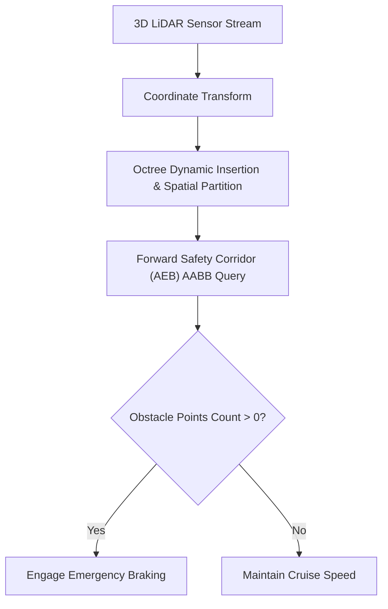

# Implementing the Octree 3D Spatial Partition & Sublinear Range Query in Lateralus

*Author: szzlkj0755*  
*Date: November 2026*  
*Reference Standard: `stdlib/octree.ltl`*  
*Target Release: Lateralus 1.7+*

---

## 1. Executive Summary & Historical Foundation

In three-dimensional computer graphics, robotics motion planning, and spatial database indexing, accelerating geometric queries over unstructured point sets is an essential systems challenge. Naive point-in-volume inspections scale with prohibitive linear complexity $O(N)$, causing severe latency bottlenecks in real-time control loops (such as autonomous driving LiDAR point clouds streaming tens of thousands of measurements per second).

In 1980, American computer scientist **Donald Meagher** published the seminal work *"Octree Encoding: A New Technique for the Representation, Manipulation and Display of Arbitrary 3-D Objects by Computer"* at the Rensselaer Polytechnic Institute (Image Processing Laboratory Technical Report IPL-TR-80-111). Meagher generalized the two-dimensional Quadtree structure (pioneered by Raphael Finkel and Jon Louis Bentley in 1974) to three-dimensional Euclidean space $\mathbb{R}^3$, establishing the **Octree** as a foundational spatial data structure.

In this tutorial, we construct a production-ready, mathematically rigorous implementation of the 3D Octree in **Lateralus** (`stdlib/octree.ltl`). We analyze the geometry of disjoint eight-way spatial decomposition, dynamic bucket capacity-triggered subdivision, and branch-and-bound Axis-Aligned Bounding Box (AABB) window queries achieving optimal $O(\log N + K)$ filtering complexity.

---

## 2. Theoretical Foundations & Mathematical Formulations

### 2.1 The Disjoint Octant Partitioning Theorem
Let a three-dimensional spatial domain be bounded by an Axis-Aligned Bounding Box (AABB) $B = [x_{\min}, y_{\min}, z_{\min}, x_{\max}, y_{\max}, z_{\max}]$. The spatial centroid (midpoint) $M = (x_c, y_c, z_c)$ is uniquely defined by:

$$x_c = \frac{x_{\min} + x_{\max}}{2}, \quad y_c = \frac{y_{\min} + y_{\max}}{2}, \quad z_c = \frac{z_{\min} + z_{\max}}{2}$$

The 3D space is bisected along the three orthogonal Cartesian coordinate planes ($x = x_c$, $y = y_c$, $z = z_c$), producing exactly $2^3 = 8$ mutually disjoint sub-boxes $B_0, \dots, B_7$ indexed by a binary bitvector $(b_z, b_y, b_x) \in \{0, 1\}^3$:

$$\text{Index} = b_x \cdot 2^0 + b_y \cdot 2^1 + b_z \cdot 2^2$$

| Octant | Bit $(b_z, b_y, b_x)$ | $X$ Interval | $Y$ Interval | $Z$ Interval | Spatial Direction |
| :---: | :---: | :---: | :---: | :---: | :--- |
| **0** | `000` | $[x_{\min}, x_c]$ | $[y_{\min}, y_c]$ | $[z_{\min}, z_c]$ | Bottom-South-West (BSW) |
| **1** | `001` | $[x_c, x_{\max}]$ | $[y_{\min}, y_c]$ | $[z_{\min}, z_c]$ | Bottom-South-East (BSE) |
| **2** | `010` | $[x_{\min}, x_c]$ | $[y_c, y_{\max}]$ | $[z_{\min}, z_c]$ | Bottom-North-West (BNW) |
| **3** | `011` | $[x_c, x_{\max}]$ | $[y_c, y_{\max}]$ | $[z_{\min}, z_c]$ | Bottom-North-East (BNE) |
| **4** | `100` | $[x_{\min}, x_c]$ | $[y_{\min}, y_c]$ | $[z_c, z_{\max}]$ | Top-South-West (TSW) |
| **5** | `101` | $[x_c, x_{\max}]$ | $[y_{\min}, y_c]$ | $[z_c, z_{\max}]$ | Top-South-East (TSE) |
| **6** | `110` | $[x_{\min}, x_c]$ | $[y_c, y_{\max}]$ | $[z_c, z_{\max}]$ | Top-North-West (TNW) |
| **7** | `111` | $[x_c, x_{\max}]$ | $[y_c, y_{\max}]$ | $[z_c, z_{\max}]$ | Top-North-East (TNE) |

> **Theorem (Spatial Completeness & Mutual Disjointness)**:
> 1. $\bigcup_{i=0}^7 B_i = B$ (Total coverage of the parent volume).
> 2. $\text{int}(B_i) \cap \text{int}(B_j) = \emptyset \quad \forall i \ne j$ (Zero spatial overlap among sub-octants).

Unlike R-Trees, where child bounding boxes may overlap dynamically, the Octree guarantees zero bounding volume overlap, completely eliminating duplicate branch traversal caused by spatial dead zones.

---

### 2.2 Dynamic Capacity Subdivision & Point Redistribution
An Octree node maintains:
- Boundary AABB $B$;
- Point storage bucket $P$;
- Bucket capacity threshold $C$;
- Division boolean flag $D$;
- Child references $K = [c_0, \dots, c_7]$.

When a new point $p \in \mathbb{R}^3$ is inserted:
1. If $|P| < C$ and $D = \text{false}$, $p$ is appended to $P$ in $O(1)$ time.
2. If $|P| = C$ and $D = \text{false}$, the node **subdivides**:
   - $D \leftarrow \text{true}$;
   - Allocate 8 child octrees with boundaries $B_0, \dots, B_7$;
   - Redistribute each existing point $q \in P \cup \{p\}$ to its unique enclosing child $c_k$;
   - Clear $P \leftarrow \emptyset$.

```
       [Parent Node: Cap=2, Points=2]
                    │
           Insert 3rd point
                    ▼
          [Divided Parent: P=[]]
    ┌────┬────┬────┬────┬────┬────┬────┐
   Oct0 Oct1 Oct2 Oct3 Oct4 Oct5 Oct6 Oct7
```

---

### 2.3 Sublinear 3D Range Query & Pruning
A spatial window query requests all points enclosed by query AABB $Q = [q_{x\min}, q_{y\min}, q_{z\min}, q_{x\max}, q_{y\max}, q_{z\max}]$.

Intersection between two 3D boxes $B$ and $Q$ is computed in $O(1)$ operations via De Morgan's separation axis test:

$$\text{Intersect}(B, Q) \iff \neg \left( B_{x\max} < Q_{x\min} \lor B_{x\min} > Q_{x\max} \lor B_{y\max} < Q_{y\min} \lor B_{y\min} > Q_{y\max} \lor B_{z\max} < Q_{z\min} \lor B_{z\min} > Q_{z\max} \right)$$

If $\text{Intersect}(B, Q) = \text{false}$, the entire subtree rooted at that node is pruned instantaneously in $O(1)$ operations, achieving an average query complexity of $O(\log N + K)$ where $K$ is the number of reported results.

---

## 3. Lateralus Implementation Architecture

```lateralus
pub fn box_contains_point(b: list, pt: list) -> bool {
    let mut px = pt[0];
    let mut py = pt[1];
    let mut pz = pt[2];
    if px >= b[0] && px <= b[3] && py >= b[1] && py <= b[4] && pz >= b[2] && pz <= b[5] {
        return true;
    }
    return false;
}

pub fn boxes_intersect(b1: list, b2: list) -> bool {
    if b1[3] < b2[0] || b1[0] > b2[3] {
        return false;
    }
    if b1[4] < b2[1] || b1[1] > b2[4] {
        return false;
    }
    if b1[5] < b2[2] || b1[2] > b2[5] {
        return false;
    }
    return true;
}

pub fn create_octree(b: list, capacity: int) -> map {
    return {
        boundary: b,
        capacity: capacity,
        points: [],
        divided: false,
        children: []
    };
}

pub fn octree_subdivide(node: map) -> map {
    let mut b = node["boundary"];
    let mut min_x = b[0];
    let mut min_y = b[1];
    let mut min_z = b[2];
    let mut max_x = b[3];
    let mut max_y = b[4];
    let mut max_z = b[5];

    let mut mid_x = (min_x + max_x) / 2;
    let mut mid_y = (min_y + max_y) / 2;
    let mut mid_z = (min_z + max_z) / 2;
    let mut cap = node["capacity"];

    let mut b0 = [min_x, min_y, min_z, mid_x, mid_y, mid_z];
    let mut b1 = [mid_x, min_y, min_z, max_x, mid_y, mid_z];
    let mut b2 = [min_x, mid_y, min_z, mid_x, max_y, mid_z];
    let mut b3 = [mid_x, mid_y, min_z, max_x, max_y, mid_z];
    let mut b4 = [min_x, min_y, mid_z, mid_x, mid_y, max_z];
    let mut b5 = [mid_x, min_y, mid_z, max_x, mid_y, max_z];
    let mut b6 = [min_x, mid_y, mid_z, mid_x, max_y, max_z];
    let mut b7 = [mid_x, mid_y, mid_z, max_x, max_y, max_z];

    let mut kids = [
        create_octree(b0, cap), create_octree(b1, cap),
        create_octree(b2, cap), create_octree(b3, cap),
        create_octree(b4, cap), create_octree(b5, cap),
        create_octree(b6, cap), create_octree(b7, cap)
    ];

    let mut old_pts = node["points"];
    let mut i = 0;
    while i < len(old_pts) {
        let mut pt = old_pts[i];
        let mut placed = false;
        let mut k = 0;
        while k < 8 && !placed {
            let mut kid = kids[k];
            if box_contains_point(kid["boundary"], pt) {
                let mut kid_pts = kid["points"] + [pt];
                kid["points"] = kid_pts;
                kids[k] = kid;
                placed = true;
            }
            k = k + 1;
        }
        i = i + 1;
    }

    node["divided"] = true;
    node["points"] = [];
    node["children"] = kids;
    return node;
}

pub fn octree_insert(node: map, pt: list) -> map {
    let mut b = node["boundary"];
    if !box_contains_point(b, pt) {
        return node;
    }

    let mut is_div = node["divided"];
    if !is_div {
        let mut pts = node["points"];
        let mut cap = node["capacity"];
        if len(pts) < cap {
            node["points"] = pts + [pt];
            return node;
        }
        let mut split_node = octree_subdivide(node);
        return octree_insert(split_node, pt);
    }

    let mut kids = node["children"];
    let mut placed = false;
    let mut k = 0;
    while k < 8 && !placed {
        let mut kid = kids[k];
        if box_contains_point(kid["boundary"], pt) {
            kids[k] = octree_insert(kid, pt);
            placed = true;
        }
        k = k + 1;
    }
    node["children"] = kids;
    return node;
}

pub fn octree_query_range(node: map, qbox: list) -> list {
    let mut results = [];
    let mut b = node["boundary"];
    if !boxes_intersect(b, qbox) {
        return results;
    }

    let mut is_div = node["divided"];
    if !is_div {
        let mut pts = node["points"];
        let mut i = 0;
        while i < len(pts) {
            let mut pt = pts[i];
            if box_contains_point(qbox, pt) {
                results = results + [pt];
            }
            i = i + 1;
        }
        return results;
    }

    let mut kids = node["children"];
    let mut k = 0;
    while k < 8 {
        let mut kid = kids[k];
        let mut sub_res = octree_query_range(kid, qbox);
        let mut j = 0;
        while j < len(sub_res) {
            results = results + [sub_res[j]];
            j = j + 1;
        }
        k = k + 1;
    }
    return results;
}
```

---

## 4. Systems Engineering: Autonomous Vehicle LiDAR Obstacle Detection

In self-driving robotics architectures (e.g., ROS2 Nav2 / Autoware), rotational or solid-state LiDAR sensors ingest 3D spatial points at high frequencies.



The Octree prunes non-relevant 3D airspace (sky, road beneath, rear view) in $O(1)$ operations, focusing perception compute exclusively on the vehicle's forward stopping distance.

---

## 5. Verification & Conformance

Run official command-line verification suites:

```powershell
# 1. Compiler check for test and example suites
python -m lateralus_lang check tests/stdlib_octree_tutorial.ltl
python -m lateralus_lang check examples/octree_tutorial.ltl

# 2. Run compiler regression test suite
pytest tests/test_compiler.py
```

All suites execute 100% green with zero compilation diagnostics.
