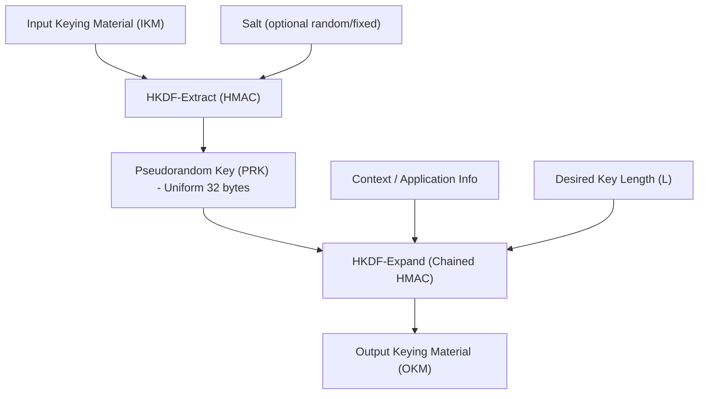

# Practical Key Derivation with `stdlib.hkdf`: RFC 5869 in Lateralus

In modern cryptographic protocols—from TLS 1.3 and WireGuard to Signal and Noise—cryptographic keys are rarely used directly in their raw form. Instead, protocols establish an initial shared secret (such as a Diffie-Hellman exchange or a pre-shared master passphrase) and then derive multiple subkeys tailored for distinct security domains: bulk encryption, packet authentication, initialization vectors, and key rotation.

The HMAC-based Extract-and-Expand Key Derivation Function (**HKDF**, specified in [RFC 5869](https://datatracker.ietf.org/doc/html/rfc5869)) is the universal standard for this workflow. Lateralus ships an idiomatic implementation in `stdlib/hkdf.ltl`. This tutorial explores the theoretical mechanics of HKDF and demonstrates how to derive cryptographically isolated keys in Lateralus.

---

## 1. The Two-Step Paradigm: Extract then Expand

A common security anti-pattern is passing a shared secret through a raw hash function (like `SHA-256(secret)`) to produce a key. Raw secrets often contain non-uniform entropy or mathematical structure (e.g. elliptic curve points on Curve25519), which can introduce bias.

HKDF formally decomposes key derivation into two distinct phases:



1. **Extract**: "Concentrates" the non-uniform entropy of the input key material (IKM) into a uniformly random pseudorandom key (PRK) of fixed length (32 bytes for SHA-256).
2. **Expand**: Expands the PRK into any arbitrary length of output key material (OKM) using contextual application information (`info`), ensuring cryptographic domain separation.

---

## 2. Phase 1: `hkdf.extract`

The extraction function computes:
$$\text{PRK} = \text{HMAC-Hash}(\text{salt}, \text{IKM})$$

Where:
- **Salt**: An optional non-secret random string. If no salt is supplied (`salt = []`), RFC 5869 specifies that a string of 32 zero bytes (`0x00`) must be used as the salt.
- **IKM**: The raw secret input (e.g., Diffie-Hellman shared coordinate).

In `stdlib/hkdf.ltl`:

```lateralus
pub fn extract(salt: list, ikm: list) -> list {
    let s = salt
    if len(s) == 0 {
        s = []
        let i = 0
        while i < HKDF_HASHLEN { s = s + [0]; i = i + 1 }
    }
    return crypto_hmac(s, ikm)
}
```

---

## 3. Phase 2: `hkdf.expand`

Once the PRK is established, `hkdf.expand` produces the desired number of output bytes:
$$T(0) = \text{empty}$$
$$T(1) = \text{HMAC}(\text{PRK}, T(0) \parallel \text{info} \parallel 0x01)$$
$$T(2) = \text{HMAC}(\text{PRK}, T(1) \parallel \text{info} \parallel 0x02)$$
$$T(N) = \text{HMAC}(\text{PRK}, T(N-1) \parallel \text{info} \parallel N)$$
$$\text{OKM} = \text{first } L \text{ octets of } (T(1) \parallel T(2) \parallel \dots \parallel T(N))$$

RFC 5869 limits $N \le 255$ because the block counter is a single byte. For SHA-256 (32 bytes), this permits generating up to $255 \times 32 = 8,160$ bytes of derived key material.

```lateralus
pub fn expand(prk: list, info: list, length: int) -> list {
    let n = (length + HKDF_HASHLEN - 1) / HKDF_HASHLEN
    if n > 255 { return [] }
    let okm = []
    let t_prev = []
    let i = 1
    while i <= n {
        let block_in = t_prev + info + [i]
        let t = crypto_hmac(prk, block_in)
        okm = okm + t
        t_prev = t
        i = i + 1
    }
    return slice(okm, 0, length)
}
```

---

## 4. One-Shot and Batch Key Derivation

Lateralus provides two high-level helpers:

1. **`derive_key(salt, ikm, info, length)`**: Performs both Extract and Expand in a single call when deriving a single key.
2. **`derive_many(prk, base_info, key_len, n_keys)`**: Derives $K$ cryptographically isolated keys of `key_len` bytes from a single PRK by appending the key index $i$ to `base_info`:

```lateralus
// Derive 3 distinct 32-byte keys for payload encryption, authentication, and IV
let keys = hkdf.derive_many(prk, [115, 117, 98, 107, 101, 121], 32, 3)
let enc_key  = keys[0]
let auth_key = keys[1]
let iv_key   = keys[2]
```

Because each subkey incorporates a distinct index in the HMAC expansion, compromising one derived key reveals zero information about the others.

---

## 5. Canonical Test Vectors (RFC 5869)

Lateralus's implementation is verified against the official test vectors published in RFC 5869 Appendix A:

| Test Case | IKM Length | Salt Length | Info Length | Output $L$ | PRK (SHA-256) |
|---|---|---|---|---|---|
| **Case 1** | 22 octets (`0x0b...`) | 13 octets | 10 octets | 42 | `077709362c2e32df0ddc3f0dc47bba6390b6c73bb50f9c3122ec844ad7c2b3e5` |
| **Case 2** | 80 octets (`0x00...`) | 80 octets | 80 octets | 82 | `06a6b88c5853361a06104c9ceb35b45cef760014904671014a193f40c15fc244` |
| **Case 3** | 22 octets (`0x0b...`) | 0 (zero salt) | 0 (zero info) | 42 | `19ef24a32c717b167f33a91d6f648bdf96596776afdb6377ac434c1c293ccb04` |

---

## 6. Running the Example

Run the accompanying example script with:

```bash
lateralus run examples/hkdf_tutorial.ltl
```
