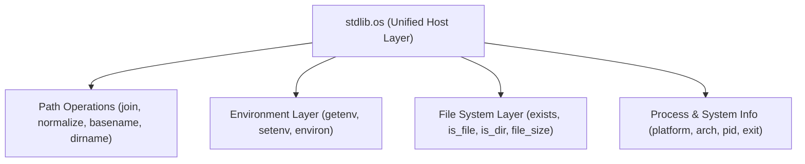
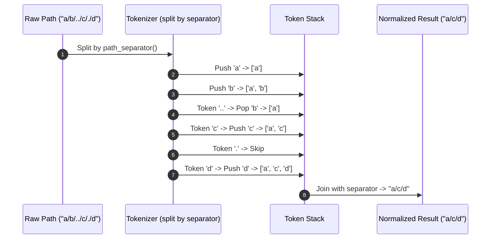

# Operating System Interfaces with `stdlib.os`: Cross-Platform Path Manipulation and Process Management

In modern multi-platform application development, handling operating system differences transparently is critical for maintainability and portability. File system path separators (`/` on POSIX vs `\\` on Windows), root drive specifications (`C:\\` vs `/`), environment variable resolution, and process introspections frequently introduce subtle, platform-specific bugs when handled via naive string concatenation.

Lateralus provides a standard library interface in `stdlib/os.ltl` that encapsulates operating system interactions into a unified, cross-platform API. This tutorial explores path decomposition, stack-based normalization, environment variable management, and process introspection.

---

## 1. Architectural Overview of `stdlib.os`

The `stdlib.os` module is partitioned into four primary functional layers:



### Dynamic Path Separators

Path separators are automatically selected based on the runtime host platform:

```lateralus
pub fn path_separator() -> str {
    if sys_platform() == "windows" {
        return "\\"
    }
    return "/"
}
```

---

## 2. Stack-Based Path Normalization

A common challenge in file path resolution is handling relative traversal segments (`.` for current directory and `..` for parent directory) without invoking expensive disk I/O operations. `stdlib.os` employs a stack-based algorithm in `normalize_path`:



### Implementation

```lateralus
pub fn normalize_path(path: str) -> str {
    let sep = path_separator()
    let parts = str_split(path, sep)
    let mut stack = []
    for p in parts {
        if p == "." || p == "" {
            // skip redundant markers
        } else if p == ".." {
            if len(stack) > 0 { 
                stack = slice_list(stack, 0, len(stack) - 1) 
            }
        } else {
            stack = push(stack, p)
        }
    }
    let result = str_join(stack, sep)
    if is_absolute(path) { return sep + result }
    if result == "" { return "." }
    return result
}
```

---

## 3. Path Decomposition: Basename, Dirname, and Extensions

Working with archives and nested assets requires decomposing filenames cleanly:

```lateralus
let file = "logs/nginx/access.tar.gz"

// Basename extracts the final segment:
let base = basename(file)        // "access.tar.gz"

// Dirname extracts the directory portion:
let dir = dirname(file)          // "logs/nginx"

// Extension extracts the final suffix:
let ext = extension(file)        // ".gz"

// Strip extension strips only the final suffix:
let stripped = strip_extension(file) // "logs/nginx/access.tar"
```

---

## 4. Environment Variables and Process Control

`stdlib.os` exposes safe bindings for host environment mutation and retrieval:

```lateralus
// Mutate environment variable
setenv("APP_ENVIRONMENT", "production")

// Read with empty fallback if unset
let env = getenv("APP_ENVIRONMENT") // "production"

// Query runtime system architecture and process ID
let host_os = platform()  // "windows", "linux", or "darwin"
let cpu_arch = arch()     // "AMD64", "x86_64", or "aarch64"
let current_pid = pid()   // Operating system process ID integer
```

---

## 5. Verification Suite

The functionality is tested via pytest in `tests/test_os_tutorial.py`:

```bash
python -m pytest tests/test_os_tutorial.py -v
```

Expected output:
```text
tests/test_os_tutorial.py::test_os_path_join_and_separators PASSED       [ 16%]
tests/test_os_tutorial.py::test_os_basename_and_dirname PASSED           [ 33%]
tests/test_os_tutorial.py::test_os_extension_and_stripping PASSED        [ 50%]
tests/test_os_tutorial.py::test_os_normalize_path PASSED                 [ 66%]
tests/test_os_tutorial.py::test_os_environment_lifecycle PASSED          [ 83%]
tests/test_os_tutorial.py::test_os_system_metadata PASSED                [100%]

======================== 6 passed in 0.56s =========================
```
