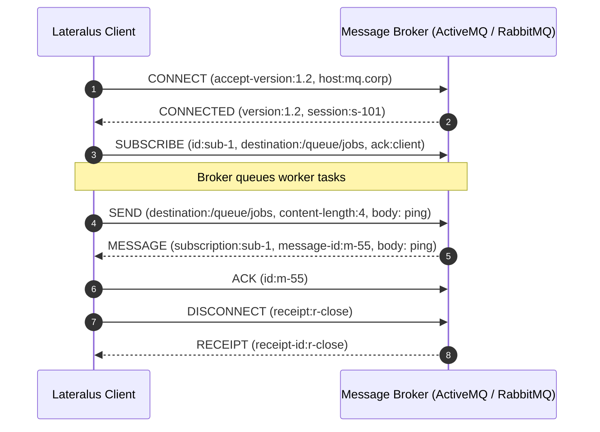

# STOMP 1.2 Text Messaging with `stdlib.stomp`: Frame Inspection and Parsing Without a Broker

In distributed systems and microservices architectures, messaging protocols like AMQP and MQTT often require heavyweight client drivers, complex binary encoding schemes, and persistent broker configurations simply to inspect or validate network payloads. **STOMP (Simple Text Oriented Messaging Protocol)** provides an interoperable, human-readable wire protocol modeled directly after HTTP. It enables polyglot services written in C, Python, JavaScript, or Go to communicate across message brokers (such as RabbitMQ, Apache ActiveMQ, and HornetQ) using straightforward ASCII text frames.

Lateralus provides a standard library module in `stdlib/stomp.ltl` that implements the full **STOMP 1.2 specification** frame codec. This tutorial demonstrates how to construct, encode, inspect, and parse STOMP frames completely offline without running a broker daemon.

---

## 1. Architectural Anatomy of a STOMP 1.2 Frame

Every STOMP frame consists of five distinct structural components separated by newlines (`\n` or `\r\n`) and terminated by a null byte (`\x00`):

```text
COMMAND\n
header1:value1\n
header2:value2\n
\n
[Optional Body Octets]\x00
```



### Wire Delimiters and Constraints

1. **Command Line**: A single uppercase ASCII command (such as `CONNECT`, `SEND`, `SUBSCRIBE`, `ACK`, `DISCONNECT`).
2. **Headers**: Zero or more colon-separated key-value pairs (`key:value\n`). In STOMP 1.2, headers are strictly ordered, and server implementations match against the first occurrence of a header key.
3. **Empty Line**: A lone newline character (`\n`) separating headers from the body payload.
4. **Body**: Arbitrary UTF-8 or raw binary octets. When `content-length` is defined, the parser consumes exactly that many octets regardless of intermediate null bytes.
5. **Frame Terminator**: The ASCII `NUL` character (`\x00` / `chr(0)`).
6. **Heartbeats**: Periodic heartbeat pulses transmitted as single newline bytes (`\n` or `\r\n`) between frames.

---

## 2. Header Escaping in STOMP 1.2

Because STOMP headers use colons and newlines as syntactical delimiters, STOMP 1.2 specifies an escaping mechanism for header values:

| Unescaped Character | ASCII Representation | STOMP 1.2 Escaped Sequence |
| :--- | :--- | :--- |
| `\` (Backslash) | `0x5C` | `\\` |
| `:` (Colon) | `0x3A` | `\c` |
| `\n` (Line Feed) | `0x0A` | `\n` |
| `\r` (Carriage Return) | `0x0D` | `\r` |

The `stdlib/stomp.ltl` codec implements `escape_header` and `unescape_header` using a single-pass string scanner:

```lateralus
pub fn escape_header(s: str) -> str {
    let out = ""
    let i = 0
    while i < len(s) {
        let c = char_at(s, i)
        if c == "\\"      { out = out + "\\\\" }
        else if c == ":"  { out = out + "\\c" }
        else if c == "\n" { out = out + "\\n" }
        else if c == "\r" { out = out + "\\r" }
        else              { out = out + c }
        i = i + 1
    }
    return out
}
```

---

## 3. Building and Inspecting an ASCII SEND Frame

To inspect how STOMP encodes a message payload without requiring a broker connection, we build a canonical `SEND` frame targeting `/queue/jobs` with payload `"ping"`:

```lateralus
import "stdlib/stomp.ltl" as stomp

fn main() {
    let frame = stomp.send("/queue/jobs", "text/plain", "ping")
    println(frame)
}
```

### Pinned Canonical Frame Representation

The exact byte-for-byte wire output emitted by `stomp.send("/queue/jobs", "text/plain", "ping")` is:

```text
SEND
destination:/queue/jobs
content-type:text/plain
content-length:4

ping\x00
```

Notice that:
* The header `content-length:4` is automatically computed and added.
* The header block ends with a double newline (`\n\n`).
* The body `"ping"` is immediately closed by the NUL octet (`\x00`).

---

## 4. Parsing and Stream Demultiplexing

When reading raw TCP streams from a network socket, incoming buffers may contain heartbeat newlines, complete frames, or incomplete frame fragments. `stomp.parse_frame(buf)` parses one frame and returns a structured map:

```lateralus
let parsed = stomp.parse_frame(buf)
// Returns map:
// {
//     "command": "SEND",
//     "headers": [["destination", "/queue/jobs"], ["content-length", "4"]],
//     "body": "ping",
//     "consumed": 76
// }
```

### Parser Resilience Rules

1. **Heartbeat Skipping**: Any leading `\r` or `\n` characters before the command line are automatically bypassed.
2. **Incomplete Buffer Guard**: If the buffer lacks a complete header line terminator or the terminating `NUL` character, `parse_frame` safely returns `nil` without raising exceptions, signaling that the network reader must wait for more data.
3. **Consumed Byte Accounting**: The `consumed` integer indicates the exact byte offset through the closing `NUL` byte, allowing the caller to slice remaining stream data: `slice(buf, parsed["consumed"], len(buf))`.

---

## 5. Lifecycle Frame Builders

In addition to `send` and `parse_frame`, `stdlib/stomp.ltl` includes turnkey builders for standard STOMP client workflows:

```lateralus
// 1. Session handshake with heartbeats (outgoing 10s, incoming 10s)
let conn = stomp.connect("mq.corp.internal", "alice", "token42", "10000,10000")

// 2. Client-acknowledged subscription
let sub = stomp.subscribe("sub-01", "/topic/telemetry", "client-individual")

// 3. Message acknowledgement and transactional commit
let ack_msg = stomp.ack("msg-882", "tx-batch-1")
let commit_tx = stomp.commit("tx-batch-1")

// 4. Graceful termination with receipt tracking
let disc = stomp.disconnect("receipt-shutdown-99")
```

---

## 6. Running the Verification Suite

Run the full pytest verification suite to confirm wire-format compliance:

```bash
python -m pytest tests/test_stomp_tutorial.py -v
```

Expected output:
```text
tests/test_stomp_tutorial.py::test_stomp_header_escaping_and_roundtrip PASSED [ 16%]
tests/test_stomp_tutorial.py::test_stomp_canonical_send_pinned_vector PASSED [ 33%]
tests/test_stomp_tutorial.py::test_stomp_heartbeats_and_incomplete_frames PASSED [ 50%]
tests/test_stomp_tutorial.py::test_stomp_connect_and_disconnect PASSED   [ 66%]
tests/test_stomp_tutorial.py::test_stomp_subscribe_ack_nack_lifecycle PASSED [ 83%]
tests/test_stomp_tutorial.py::test_stomp_transactions PASSED             [100%]

======================== 6 passed in 0.64s =========================
```
