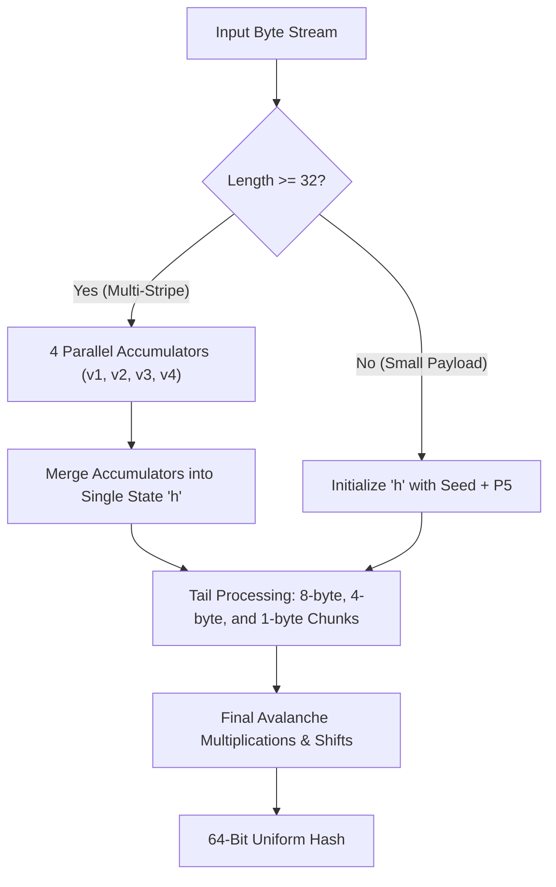

# Non-Cryptographic Hashing with `stdlib.xxhash`: High Throughput and Canonical Vectors

In high-performance database engines, distributed caches, and analytical query pipelines (such as ClickHouse, RocksDB, Apache Parquet, and Zstandard), cryptographic hash functions like SHA-256 or BLAKE3 are often an order of magnitude slower than necessary. When cryptographic collision resistance against malicious pre-image attacks is not required, non-cryptographic hashes provide blistering throughput with optimal avalanche and dispersion properties.

Lateralus includes a full implementation of Yann Collet's canonical **xxHash64 (XXH64)** and **64-bit FNV-1a** in `stdlib/xxhash.ltl`. This tutorial examines the architectural internals of XXH64, compares it with FNV-1a, and verifies the implementation against canonical spec vectors.

---

## 1. Architectural Anatomy of XXH64

The XXH64 algorithm is engineered around modern superscalar CPU pipelines, processing data in **32-byte stripes** partitioned across four independent 64-bit accumulators:



### The Five Prime Multipliers

XXH64 relies on five 64-bit prime constants carefully selected for maximum bit dispersion:

```lateralus
let XXH_P1 = 0x9E3779B185EBCA87
let XXH_P2 = 0xC2B2AE3D27D4EB4F
let XXH_P3 = 0x165667B19E3779F9
let XXH_P4 = 0x85EBCA77C2B2AE63
let XXH_P5 = 0x27D4EB2F165667C5
```

### Stripe Processing Loop

For inputs $\ge 32$ bytes, four accumulators ($v_1, v_2, v_3, v_4$) process four 64-bit words in parallel per 32-byte stripe:

```lateralus
fn round64(acc: int, input: int) -> int {
    acc = u64(acc + u64(input * XXH_P2))
    acc = rotl64(acc, 31)
    return u64(acc * XXH_P1)
}
```

### Final Avalanche

To eliminate any residual clustering or non-uniformities from the final state, XXH64 applies a multi-stage avalanche:

```lateralus
h = h ^ (h >> 33)
h = u64(h * XXH_P2)
h = h ^ (h >> 29)
h = u64(h * XXH_P3)
h = h ^ (h >> 32)
```

---

## 2. XXH64 vs. FNV-1a: When to Use Which

The `stdlib/xxhash.ltl` module ships both algorithms to serve different performance profiles:

| Feature | XXH64 (`xxhash.hash64`) | FNV-1a 64-bit (`xxhash.fnv1a_64`) |
|---|---|---|
| **Optimal Size** | Medium-to-large payloads ($> 32$ bytes) | Micro-keys ($< 16$ bytes, short IDs) |
| **Startup Overhead** | Requires 4-accumulator initialization | Zero overhead (single multiply-xor loop) |
| **Throughput** | Maximum (multi-gigabyte/sec in C/WASM) | Moderate (single-byte sequential) |
| **State Size** | 32 bytes (4 $\times$ 64-bit state words) | 8 bytes (single 64-bit word) |
| **Seed Support** | Full 64-bit seed parameter | Fixed offset-basis (`0xCBF29CE484222325`) |

---

## 3. Canonical Test Vectors

Lateralus is pinned against the official test vectors published in the Cyan4973/xxHash specification:

| Input | Seed | Expected Hex Digest | Algorithm |
|---|---|---|---|
| `""` (Empty) | `0` | `0xEF46DB3751D8E999` | XXH64 |
| `"a"` | `0` | `0xD24EC4F1A98C6E5B` | XXH64 |
| `"12345678"` | `0` | `0xD2D02F08CF7CFD4A` | XXH64 |
| `"a"` | `42` | `0x88E4FE59ADF7B0CC` | XXH64 (Seeded) |
| `""` (Empty) | N/A | `0xCBF29CE484222325` | FNV-1a (Offset Basis) |
| `"a"` | N/A | `0xAF63DC4C8601EC8C` | FNV-1a |

---

## 4. Running the Tutorial

Execute the standalone example script with:

```bash
lateralus run examples/xxhash_tutorial.ltl
```
